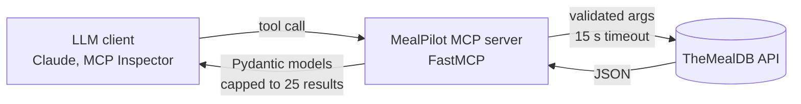

# MealPilot MCP

[](LICENSE)
[]()
[]()

A Model Context Protocol (MCP) server that turns the public [TheMealDB](https://www.themealdb.com/api.php) recipe API into four typed tools an LLM agent can call: search meals by name, filter by ingredient, fetch full recipe details, and get a random meal.



## Tools

| Tool | Arguments | Returns |
|---|---|---|
| `search_meals_by_name` | `query`, `limit` (1-25, default 5) | List of `MealCard` |
| `meals_by_ingredient` | `ingredient`, `limit` (1-25, default 12) | List of `MealCard` |
| `meal_details` | `id` | `MealDetails` |
| `random_meal` | none | `MealDetails` |

## Data models

```python
class MealCard(BaseModel):
    id: str
    name: str
    area: Optional[str]
    category: Optional[str]
    thumb: Optional[str]

class IngredientMeasure(BaseModel):
    name: str
    measure: Optional[str]

class MealDetails(BaseModel):
    id: str
    name: str
    category: Optional[str]
    area: Optional[str]
    instructions: Optional[str]
    image: Optional[str]
    source: Optional[str]
    youtube: Optional[str]
    ingredients: List[IngredientMeasure]
```

## Design choices

- **Typed contracts:** every tool returns Pydantic models, so the agent gets a predictable schema.
- **Bounded output:** results are capped at 25 per call to keep agent context small.
- **Input hygiene:** empty queries return an empty list, and unknown meal IDs raise a clear error.
- **Network safety:** a 15-second timeout on every request, with structured logging to stderr so it does not corrupt the MCP stdio channel.

## Run it

```bash
git clone https://github.com/vrushabh05/mealpilot-mcp.git
cd mealpilot-mcp
python -m venv .venv && source .venv/bin/activate   # Windows: .venv\Scripts\activate
pip install -r requirements.txt
mcp dev meals_server.py        # opens the MCP Inspector to try the tools
```

To use it from an MCP client, point the client's config at `python meals_server.py`.

## Stack

`Python` `MCP (FastMCP)` `Pydantic` `requests`

## Acknowledgements

Recipe data from TheMealDB.
